# Bitacora Corte 2 - La Brasa Viva

Plataforma de gestion y API REST para restaurante tipo parrilla.
Autor: Carlos Sanchez
Materia: Desarrollo y Operacion de Software (DOSW) - Escuela Colombiana de Ingenieria Julio Garavito

---

## Tabla de Contenido

1. [Descripcion General](#1-descripcion-general)
2. [Arquitectura y Diagramas C4](#2-arquitectura-y-diagramas-c4)
   - [Diagrama de Contexto](#diagrama-de-contexto)
   - [Diagrama de Componentes General](#diagrama-de-componentes-general)
   - [Diagrama de Componentes Especifico](#diagrama-de-componentes-especifico)
   - [Diagrama de Despliegue](#diagrama-de-despliegue)
3. [Persistencia Hibrida y Base de Datos](#3-persistencia-hibrida-y-base-de-datos)
4. [Seguridad en la API (Spring Security y JWT)](#4-seguridad-en-la-api-spring-security-y-jwt)
   - [Esquema de Autenticacion y Roles](#esquema-de-autenticacion-y-roles)
   - [Cuentas Sembradas por Defecto](#cuentas-sembradas-por-defecto)
   - [Cabeceras de Seguridad y CORS](#cabeceras-de-seguridad-y-cors)
   - [Alineacion con OWASP Top 10](#alineacion-con-owasp-top-10)
5. [Contenedorizacion con Docker](#5-contenedorizacion-con-docker)
   - [Estrategia Dockerfile Multi-Etapa](#estrategia-dockerfile-multi-etapa)
   - [Orquestacion con Docker Compose](#orquestacion-con-docker-compose)
   - [Variables de Entorno](#variables-de-entorno)
6. [Integracion y Despliegue Continuo (CI/CD)](#6-integracion-y-despliegue-continuo-cicd)
   - [Estrategia de Ambientes: QA y PROD](#estrategia-de-ambientes-qa-y-prod)
   - [Pipelines de GitHub Actions](#pipelines-de-github-actions)
   - [Secretos Requeridos en GitHub](#secretos-requeridos-en-github)
   - [URLs de Despliegue en la Nube](#urls-de-despliegue-en-la-nube)
7. [Modulos Funcionales y Reglas de Negocio](#7-modulos-funcionales-y-reglas-de-negocio)
8. [Pruebas Automatizadas y Validacion](#8-pruebas-automatizadas-y-validacion)

---

## 1. Descripcion General

El proyecto corresponde al backend del restaurante La Brasa Viva, desarrollado con Spring Boot y Java 21. El sistema atiende los requerimientos operativos de un restaurante de carnes y parrilla, integrando la atencion al comensal, el procesamiento de comandas en cocina, la facturacion por mesa, el agendamiento de reservas y el control de cupos de parqueadero.

La aplicacion implementa arquitectura por capas desacoplada, persistencia hibrida relacional y documental, esquema de seguridad sin estado basado en JSON Web Tokens, pruebas automatizadas de integracion y configuracion para ejecucion en contenedores Docker y despliegue continuo mediante GitHub Actions.

---

## 2. Arquitectura y Diagramas C4

### Diagrama de Contexto

El diagrama de contexto ubica el sistema del restaurante La Brasa Viva dentro de su entorno operativo e ilustra las fronteras de interaccion con los usuarios y servicios externos.

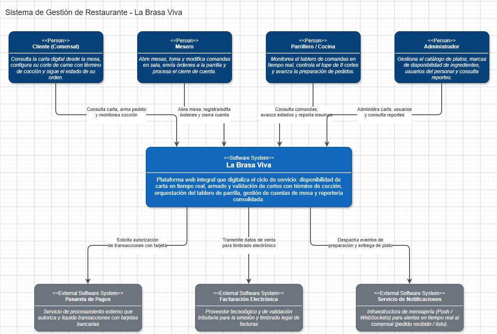

Explicacion del diagrama de contexto:
El sistema central interactua con seis actores principales y dos repositorios de datos externos. Los clientes acceden para consultar la carta y registrar reservas; los meseros gestionan pedidos y atienden las mesas; el personal de cocina visualiza y actualiza el avance de los platos; los cajeros controlan el recaudo y emision de cuentas; el operador de parqueadero fiscaliza vehiculos; y el administrador supervisa el sistema y la configuracion global. Como limites externos, el sistema delega la persistencia relacional a una instancia PostgreSQL en la nube y el registro de auditoria asincrono a un cluster MongoDB Atlas.

### Diagrama de Componentes General

El diagrama de componentes general presenta la division en capas logicas del backend y la cooperacion entre subsistemas internos.

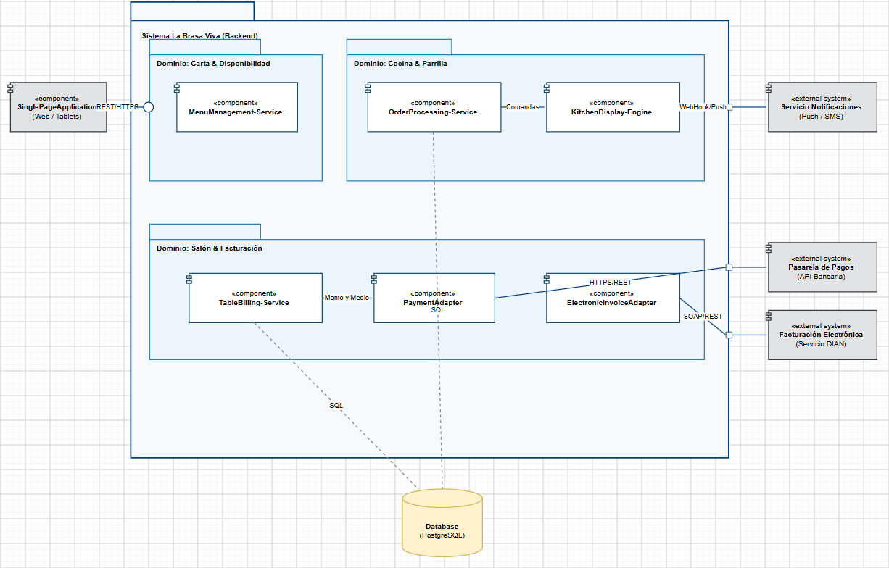

Explicacion del diagrama general:
La recepcion de peticiones se gestiona en la capa de controladores REST, la cual valida las entradas y deriva el procesamiento a la capa de servicios de aplicacion. La capa de servicios coordina las reglas del negocio, interactua con los mapeadores MapStruct para transformar DTOs y delega las operaciones transaccionales a la capa de repositorios JPA y MongoDB. El manejo de errores transversal es interceptado de manera unificada por el controlador de excepciones global, garantizando respuestas estandarizadas a los clientes.

### Diagrama de Componentes Especifico

El diagrama de componentes especifico detalla los paquetes, clases clave y flujos de datos particulares por cada dominio del restaurante.

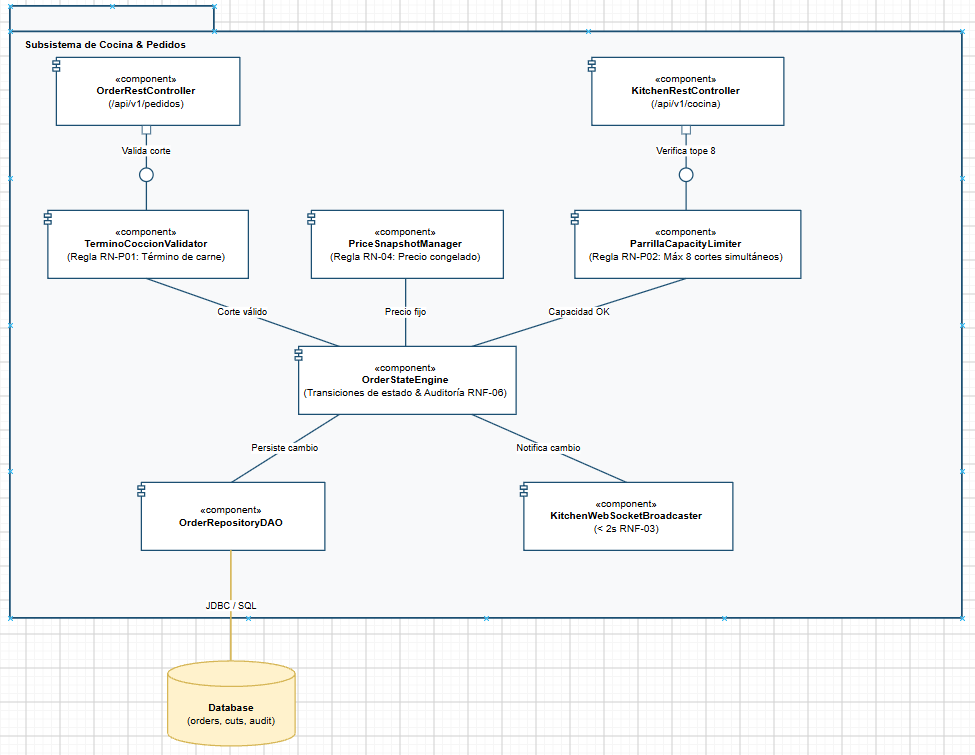

Explicacion del diagrama especifico:
Se aprecian las estructuras concretas que conforman cada modulo:
- Modulo de Platos: PlatoController, PlatoService, PlatoRepository y PlatoEntity.
- Modulo de Pedidos: PedidoController, PedidoService, PedidoRepository, PedidoEntity y ItemPedidoEntity.
- Modulo de Cuentas: CuentaController, CuentaService, CuentaRepository y CuentaEntity.
- Modulo de Reservas: ReservaController, ReservaService, ReservaRepository y ReservaEntity.
- Modulo de Parqueadero: RegistroVehiculoController, RegistroVehiculoService, RegistroVehiculoRepository y RegistroVehiculoEntity.
- Modulo de Auditoria: EventoAuditoriaController, EventoAuditoriaService, EventoAuditoriaRepository y EventoAuditoriaDocument.
- Modulo de Seguridad: AuthController, JwtAuthFilter, UsuarioDetailsService, SecurityConfig y UsuarioEntity.

### Diagrama de Despliegue

El diagrama de despliegue modela la topologia fisica y en la nube donde reside el software tanto en desarrollo local como en los ambientes remotos de QA y Produccion.

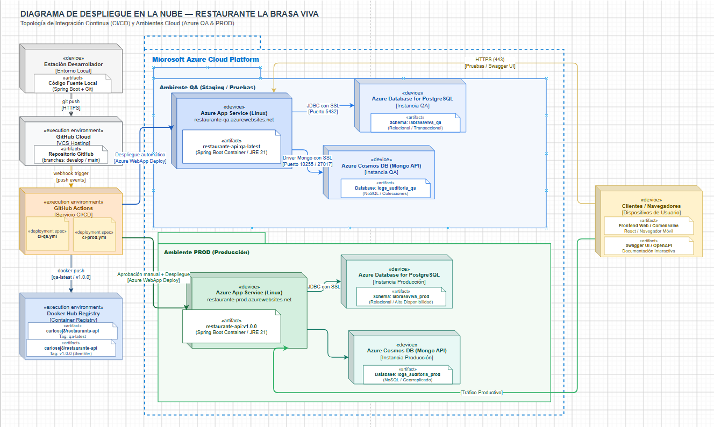

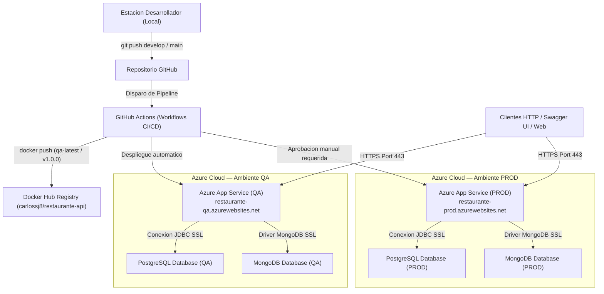

Explicacion del diagrama de despliegue:
El flujo de entrega inicia cuando el desarrollador envia cambios a GitHub. GitHub Actions compila, ejecuta pruebas unitarias y genera la imagen de contenedor que se almacena en Docker Hub. Para el ambiente de QA, el despliegue al Azure App Service se realiza de forma automatica ante cada actualizacion en las ramas principales. Para el ambiente de Produccion, el flujo exige un tag semantico de version y la aprobacion manual de los revisores autorizados en GitHub Environments. Ambos ambientes mantienen bases de datos relacionales y documentales aisladas para evitar cruce de informacion entre pruebas y operacion real.

---

## 3. Persistencia Hibrida y Base de Datos

Inicialmente el proyecto utilizaba una base de datos embebida en memoria orientada a pruebas tempranas de desarrollo. Con el proposito de garantizar que la informacion se conserve permanentemente, no se pierda al reiniciar o detener el servidor y pueda ser consultada o auditada desde clientes externos, se migro a un esquema de persistencia real:

- Base de Datos Relacional (PostgreSQL): Aloja las entidades de negocio centrales (usuarios, platos, pedidos, items, cuentas, reservas y vehiculos de parqueadero). Se encuentra alojada en Neon bajo conexion segura con SSL obligatorio. Las definiciones de tablas e indices son sincronizadas mediante Hibernate con la propiedad ddl-auto=update.
- Base de Datos Documental (MongoDB): Aloja la bitacora de eventos y auditoria en MongoDB Atlas. Cada operacion significativa (cambios de estado de pedidos, cierres de cuenta, accesos) genera un documento de auditoria que se persiste de manera asincrona sin bloquear el hilo principal HTTP.
- Gestion Externa: El estado de los registros se valida directamente utilizando DBeaver mediante la cadena de conexion JDBC configurada en el proyecto.

### Evidencia de Funcionamiento de la Persistencia
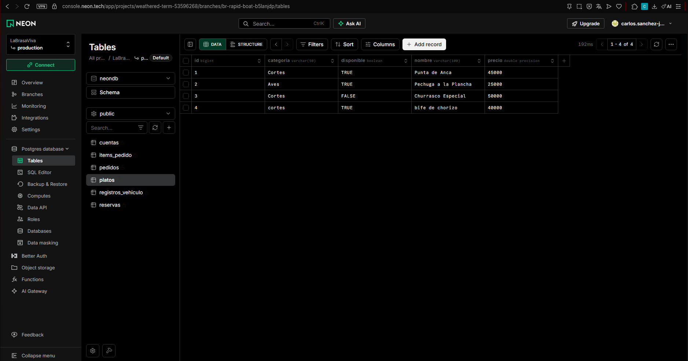

---

## 4. Seguridad en la API (Spring Security y JWT)

La aplicacion implementa un modelo de seguridad sin estado (stateless) basado en JSON Web Tokens (JJWT 0.12.3) y Spring Security 6.

### Esquema de Autenticacion y Roles

1. El usuario envia sus credenciales al endpoint `/api/v1/auth/login`.
2. El sistema valida las credenciales contrastando la contrasena cifrada con BCrypt.
3. Se genera un token JWT firmado mediante algoritmo HMAC-SHA256 con tiempo de expiracion de 1 hora.
4. En cada peticion posterior a endpoints protegidos, el cliente suministra el encabezado `Authorization: Bearer <token>`.
5. El filtro `JwtAuthFilter` intercepta la solicitud antes del despacho de Spring, valida la firma del token y carga el contexto de seguridad con los roles del usuario.

Matriz de autorizacion por rol:
- Endpoint `/api/platos` (GET): Acceso publico sin token (`permitAll`).
- Endpoint `/api/v1/auth/**`: Acceso publico para login y registro.
- Endpoint `/swagger-ui/**`, `/v3/api-docs/**`: Acceso publico a documentacion interactiva.
- Endpoint `/api/platos` (POST, PUT, DELETE): Restringido a administradores (`ROLE_ADMIN`).
- Endpoint `/api/pedidos` (POST, GET): Permitido para meseros y administradores (`ROLE_MESERO`, `ROLE_ADMIN`).
- Endpoint `/api/pedidos/{id}/estado` (PATCH): Permitido para personal de cocina (`ROLE_COCINA`, `ROLE_ADMIN`).
- Endpoint `/api/cuentas/**`: Permitido para cajeros y administradores (`ROLE_CAJERO`, `ROLE_ADMIN`).
- Endpoint `/api/reservas/**`: Permitido para clientes, meseros y administradores (`ROLE_CLIENTE`, `ROLE_MESERO`, `ROLE_ADMIN`).
- Endpoint `/api/parqueadero/**`: Permitido para operador de parqueadero y administradores (`ROLE_PARQUEADERO`, `ROLE_ADMIN`).
- Endpoint `/api/eventos/**`: Restringido a administradores (`ROLE_ADMIN`).

### Cuentas Sembradas por Defecto

Para facilitar pruebas y evaluacion, el sistema inicializa automaticamente en base de datos las siguientes cuentas:

- Administrador: `admin@labrasaviva.com` / `admin123` (Rol: ROLE_ADMIN)
- Mesero: `mesero@labrasaviva.com` / `mesero123` (Rol: ROLE_MESERO)
- Cocinero: `cocina@labrasaviva.com` / `cocina123` (Rol: ROLE_COCINA)
- Cajero: `cajero@labrasaviva.com` / `cajero123` (Rol: ROLE_CAJERO)
- Cliente: `cliente@labrasaviva.com` / `cliente123` (Rol: ROLE_CLIENTE)
- Parqueadero: `parqueadero@labrasaviva.com` / `parqueadero123` (Rol: ROLE_PARQUEADERO)

### Cabeceras de Seguridad y CORS

La configuracion en `SecurityConfig` y `CorsConfig` aplica medidas de endurecimiento HTTP:
- Desactivacion de CSRF por operar bajo arquitectura API REST desacoplada sin sesiones en servidor.
- Proteccion contra Clickjacking mediante `X-Frame-Options: DENY`.
- Prevencion de ataques de tipo MIME mediante `X-Content-Type-Options: nosniff`.
- Politica CORS configurada para permitir peticiones desde origenes confiables especificando metodos HTTP explicitos y cabeceras de autorizacion.

### Alineacion con OWASP Top 10

- Broken Object Level Authorization (BOLA): Los endpoints validan el rol y la correspondencia de permisos antes de ejecutar operaciones sobre los recursos.
- Broken Authentication: Contrasenas protegidas mediante hash BCrypt con salt automatico; tokens JWT firmados con clave simetrica de 256 bits y caducidad estricta.
- Security Misconfiguration: Desactivacion de credenciales por defecto de Spring Security, mensajes de error controlados por manejador global sin exposicion de trazas internas.
- Broken Function Level Authorization: Bloqueo a nivel de ruta y comprobacion jerarquica de roles en endpoints administrativos.

### Evidencias de Seguridad

Autenticacion en Swagger mediante Bearer Token:
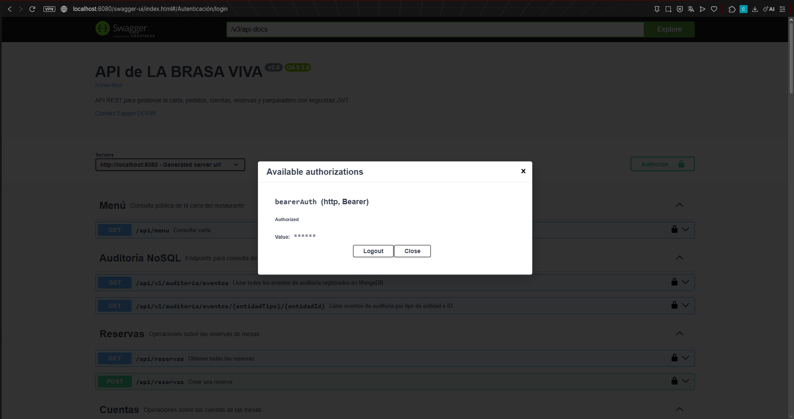

Respuesta HTTP 401 Unauthorized ante credenciales invalidas o token ausente:
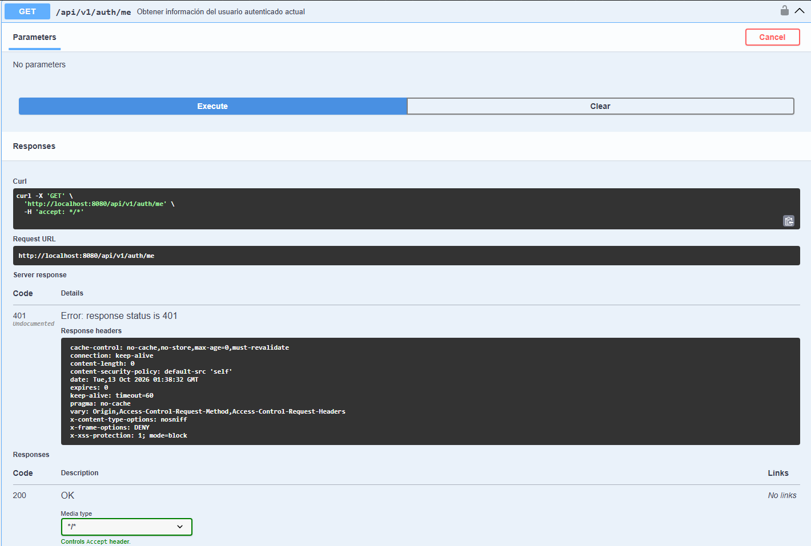

Respuesta HTTP 403 Forbidden ante rol insuficiente:
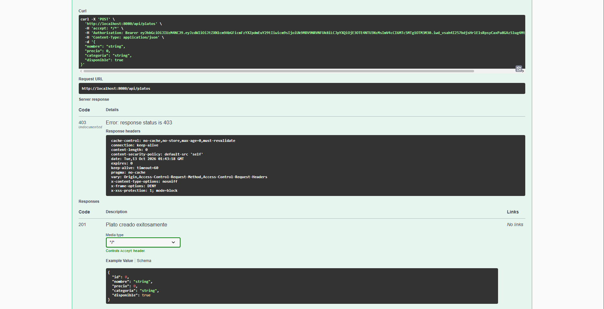

---

## 5. Contenedorizacion con Docker

### Estrategia Dockerfile Multi-Etapa

El archivo `Dockerfile` emplea una construccion en dos etapas para optimizar el peso de la imagen final y reforzar la seguridad en produccion:

1. Etapa de Compilacion (Builder): Utiliza `maven:3.9-eclipse-temurin-21`. Descarga dependencias en cache, compila el codigo fuente y empaqueta el artefacto ejecutable `app.jar`.
2. Etapa de Runtime: Utiliza `eclipse-temurin:21-jre-alpine`. Contiene unicamente el entorno de ejecucion ligero de Java sin herramientas de compilacion ni codigo fuente, reduciendo la superficie de ataque y el tamano del artefacto.

### Orquestacion con Docker Compose

El archivo `docker-compose.yml` permite iniciar en un solo paso la API, la base de datos PostgreSQL y la base de datos MongoDB sobre una red interna compartida (`restaurante-net`):

```bash
# Iniciar todos los contenedores en segundo plano
docker compose up -d

# Consultar estado de los contenedores
docker compose ps

# Visualizar logs del servicio api
docker compose logs -f api

# Detener los contenedores conservando los volumenes de datos
docker compose down
```

### Variables de Entorno

El archivo `.env.example` documenta las variables requeridas por Docker Compose. Para levantar el entorno se debe copiar dicho archivo como `.env`:

- `JWT_SECRET`: Llave secreta en Base64 utilizada para firmar los tokens JWT.
- `POSTGRES_DB`: Nombre de la base de datos relacional (por defecto: `restaurante`).
- `POSTGRES_USER`: Usuario administrador de PostgreSQL.
- `POSTGRES_PASSWORD`: Contrasena del usuario PostgreSQL.
- `MONGO_INITDB_ROOT_USERNAME`: Usuario administrador de MongoDB.
- `MONGO_INITDB_ROOT_PASSWORD`: Contrasena de MongoDB.
- `MONGO_INITDB_DATABASE`: Nombre de la base de datos documental.

### Evidencia de Contenedores en Ejecucion
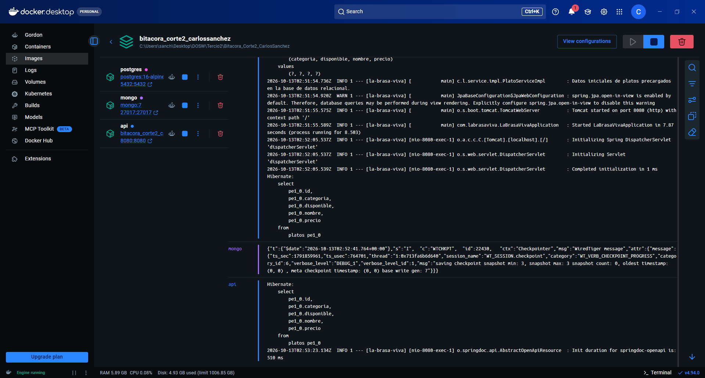

---

## 6. Integracion y Despliegue Continuo (CI/CD)

### Estrategia de Ambientes: QA y PROD

El ciclo de despliegue contempla dos ambientes independientes:
- Ambiente QA: Se actualiza automaticamente cada vez que se realiza un push a las ramas `develop` o `main`. Su objetivo es permitir la validacion integral por parte del equipo sobre una instancia en linea.
- Ambiente PROD: Se activa al crear un tag de versionamiento semantico (`v*.*.*`). Requiere revision y aprobacion manual obligatoria mediante la politica de revisores de GitHub Environments antes de ejecutar el despliegue al servidor productivo.

### Pipelines de GitHub Actions

Los flujos residen en `.github/workflows/`:
- `ci-qa.yml`: Ejecuta el checkout del codigo, configura Java 21 Temurin, ejecuta la suite de pruebas unitarias y de seguridad con Maven, construye la imagen Docker etiquetada como `qa-latest`, la publica en Docker Hub y actualiza el Azure Web App de QA.
- `ci-prod.yml`: Descarga el release con tag de version, autentica contra Docker Hub, compila la imagen con la etiqueta de version semantica y el tag `latest`, solicita aprobacion manual en el environment `production` y despliega al Azure Web App de Produccion.

### Secretos Requeridos en GitHub

Para el correcto funcionamiento de los workflows se deben registrar los siguientes secretos en el repositorio (Settings -> Secrets and variables -> Actions):

- `DOCKERHUB_USERNAME`: Nombre de usuario de la cuenta Docker Hub.
- `DOCKERHUB_TOKEN`: Personal Access Token generado en Docker Hub con permisos de lectura y escritura.
- `AZURE_CREDENTIALS`: Objeto JSON del Service Principal de Azure con rol Contributor.
- `AZURE_WEBAPP_NAME_QA`: Nombre asignado al App Service de QA en Azure.
- `AZURE_WEBAPP_NAME_PROD`: Nombre asignado al App Service de Produccion en Azure.
- `JWT_SECRET_QA`: Llave secreta para tokens JWT en el ambiente de QA.
- `JWT_SECRET_PROD`: Llave secreta de alta entropia para el ambiente productivo.
- `DB_PASSWORD_QA`: Contrasena de la base de datos PostgreSQL en QA.
- `DB_PASSWORD_PROD`: Contrasena de la base de datos PostgreSQL en Produccion.

### URLs de Despliegue en la Nube

- Documentacion Swagger QA: `https://restaurante-qa.azurewebsites.net/swagger-ui/index.html`
- Documentacion Swagger PROD: `https://restaurante-prod.azurewebsites.net/swagger-ui/index.html`

### Evidencias de CI/CD y Despliegue

Pipeline de GitHub Actions ejecutado con exito:
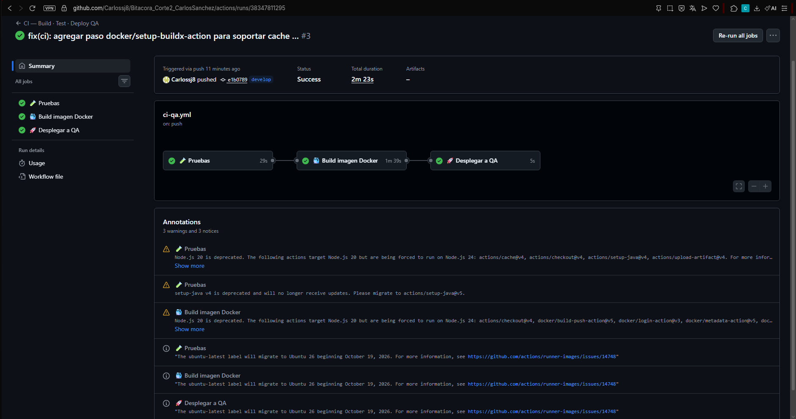

Aprobacion manual de despliegue a produccion en GitHub:
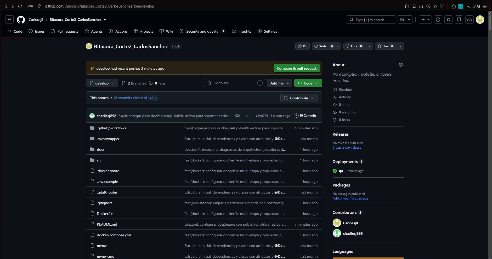

Repositorio de imagenes en Docker Hub con etiquetas de version:
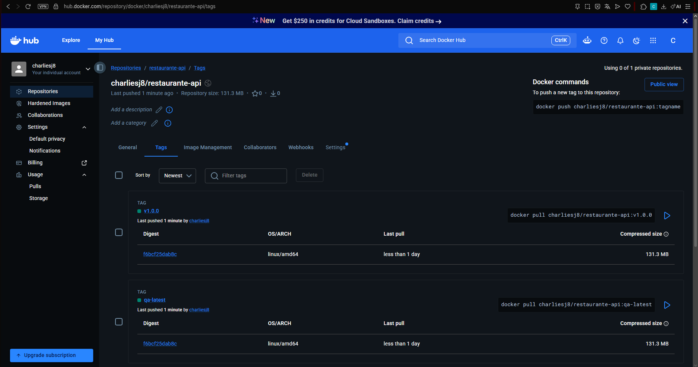

Azure App Service en ejecucion activa:
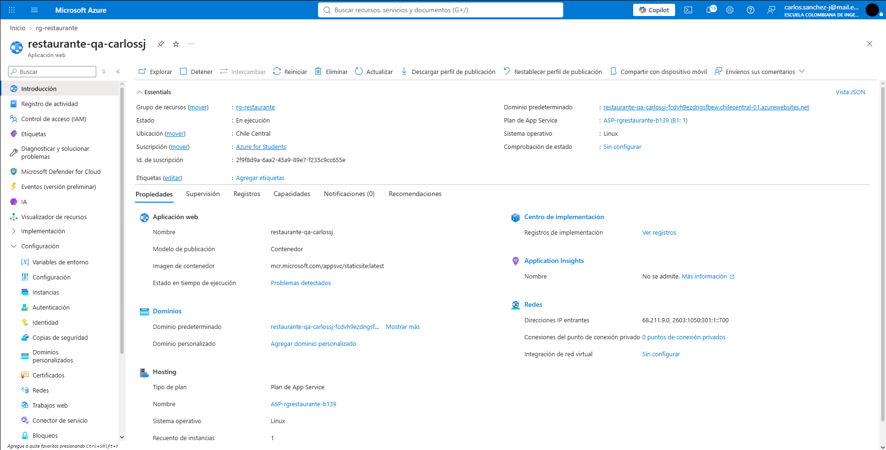

---

## 7. Modulos Funcionales y Reglas de Negocio

El sistema cubre cinco dominios funcionales principales:

1. Gestion de Platos: Catalogo categorizado con validacion de precios positivos, control de duplicados de nombre y conmutacion de disponibilidad para evitar ordenar platos agotados.
2. Gestion de Pedidos: Asociacion de items a mesas, congelamiento de precio al ordenar, exigencia de termino de coccion para cortes de carne a la parrilla y maquina de transicion de estados: RECIBIDO, EN_PREPARACION, LISTO y ENTREGADO.
3. Gestion de Cuentas: Control de una unica cuenta activa simultanea por mesa, acumulacion de pedidos entregados, calculo de subtotales, propina voluntaria sugerida y restriccion estricta que impide cerrar la cuenta si existen platos pendientes en cocina.
4. Modulo de Reservas: Asignacion de reservas con control de traslape horario, bloqueando la programacion de otra reserva en la misma mesa dentro de un margen menor a dos horas.
5. Control de Parqueadero: Registro de entrada y salida de vehiculos, validacion de ingreso unico para evitar placas duplicadas en el recinto y liquidacion automatica del cobro por permanencia.

---

## 8. Pruebas Automatizadas y Validacion

Se cuenta con una suite completa de pruebas unitarias y de integracion ejecutadas mediante JUnit 5, Mockito y Spring Security Test.

Resultados obtenidos en el entorno de desarrollo:
- Total de pruebas ejecutadas: 27
- Pruebas fallidas: 0
- Errores de ejecucion: 0
- Estado de construccion: BUILD SUCCESS

Las pruebas cubren los caminos de exito y escenarios borde de cada servicio, asi como las politicas de acceso publico y restringido de la capa de seguridad.

### Evidencia de Pruebas Automatizadas
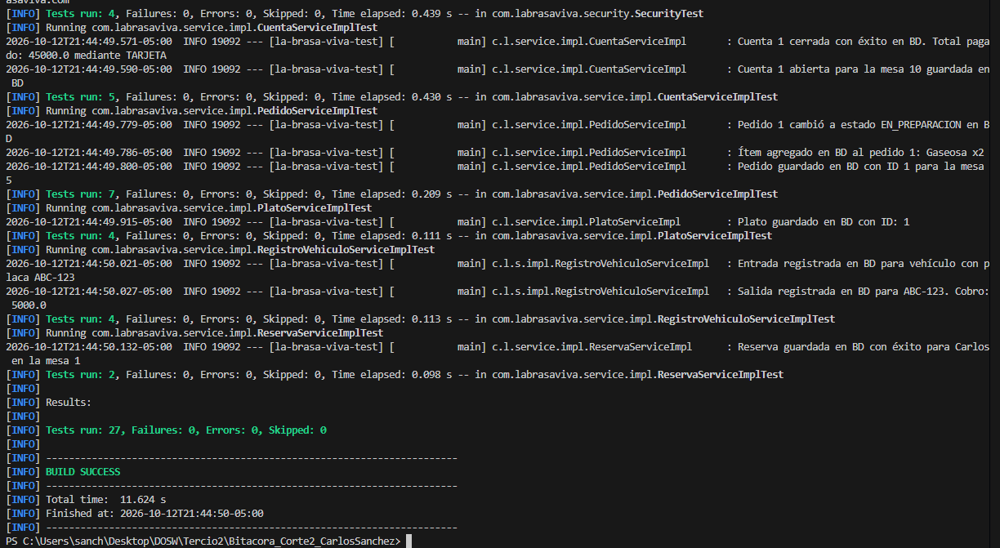
